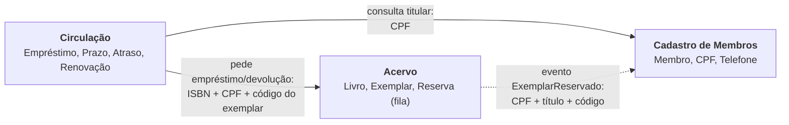

# Mapa de bounded contexts

O SGB continua sendo um **monólito** (ADR 0001/0002); os contextos abaixo são fronteiras
**lógicas** do domínio (DT-04), derivadas do modelo do CKP1 (Membro, Livro, Exemplar,
Empréstimo, Reserva) e do glossário (Acervo, Catálogo, Fila de reserva, Atraso, Renovação...).

## Contextos e justificativa das fronteiras

| Contexto | Responsabilidade | Por que está junto | Classes no código |
|---|---|---|---|
| **Acervo** | O que a biblioteca possui e em que situação física está cada exemplar; a fila de espera por título | Fila e exemplares mudam juntos: devolver um exemplar decide, na mesma regra, se ele fica livre ou reservado (RF-08). Por isso `Reserva` mora no agregado `Livro` | `Livro`, `Exemplar` (+estados), `Reserva`, `ISBN`, `CodigoExemplar`, `Disponibilidade` |
| **Circulação** | O ato de emprestar: prazo de 14 dias, atraso, devolução, renovação | Todas as regras dependem de datas e do ciclo de vida do empréstimo, e mudam por motivos de política da biblioteca, não do catálogo | `Emprestimo`, `PRAZO_DO_EMPRESTIMO_EM_DIAS` |
| **Cadastro de Membros** | Quem é a pessoa e como contatá-la | Dado pessoal (LGPD, RNF-05) muda por razões diferentes e tem restrição de acesso própria (RF-12) | `Membro`, `CPF`, `Telefone` |

Por que os outros ficam separados: `Emprestimo` não precisa saber se o exemplar está numa estante
ou reservado (o Acervo decide), e nenhum dos dois precisa conhecer telefone ou nome do membro.
Não separamos por camada técnica (banco/API/UI): o critério é o significado dos termos.

## Termos que mudam de significado

| Termo | No Acervo | Em Circulação | No Cadastro |
|---|---|---|---|
| **Livro** | A obra/título (ISBN) com N cópias | Apenas a referência (`isbn`) do que foi emprestado | — |
| **Exemplar** | A cópia física e sua situação (disponível, emprestado, reservado) | O item concreto que saiu da biblioteca (`codigo_exemplar`) | — |
| **Disponível** | Há cópia **na estante** (não reservada) | "Pode ser emprestado *a este membro*": a cópia reservada está disponível para quem reservou e não para os demais | — |
| **Membro** | Identificado só pelo CPF na fila | Titular do empréstimo; importa se tem atraso | Pessoa com nome, CPF e telefone |
| **Atraso** | — | Empréstimo em aberto após a data prevista | — |

## Relação com o modelo do CKP1
Entidades e VOs do CKP1 mapeiam 1:1 para o código. Mudança consciente: `Reserva` virou parte do
agregado `Livro` (a fila só existe junto ao título), e as *datas do domínio* são `datetime.date`
dentro de `Emprestimo` e `Reserva`.

## Fronteiras na prática hoje
Os arquivos de `src/sgb/dominio/` seguem esta tabela, mas ainda não há pacotes por contexto (DT-04).
A comunicação entre contextos já usa só identificadores (CPF, ISBN, código do exemplar) e o evento
`ExemplarReservado`, o que facilita a decisão da Aula 09.
