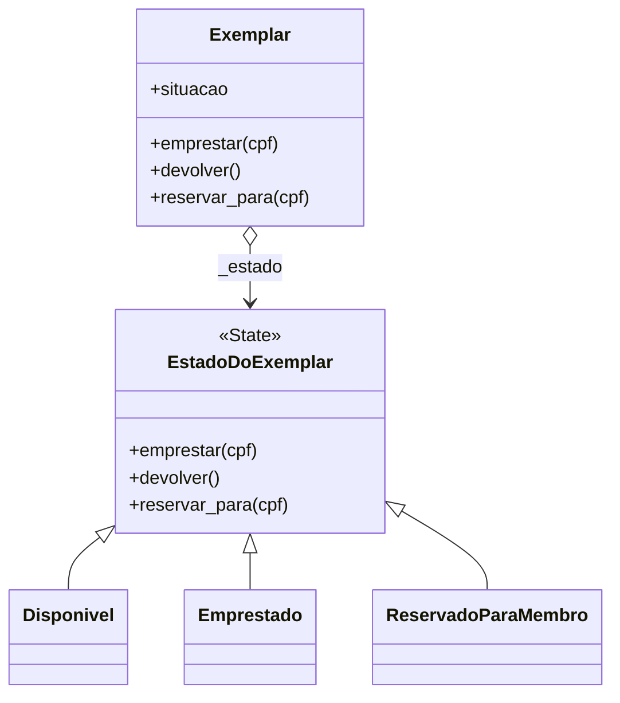
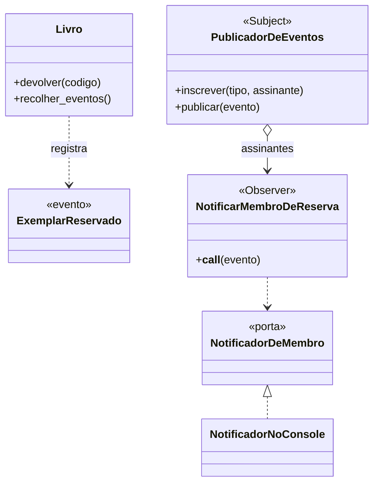

# Refatorações e padrões GoF aplicados

Regra seguida: **testes verdes antes e depois de cada commit `refactor:`**, e nenhuma mudança de
comportamento dentro deles. Antes de mexer no `Exemplar`, o commit `test:` congelou o
comportamento atual (teste de caracterização, `tests/test_exemplar.py`).

## Refatoração 1 — State para a situação do Exemplar (padrão 1)

**Smell:** *switch statements* (condicional por tipo repetido) em `src/sgb/dominio/exemplar.py` —
três métodos decidiam com `if situacao == ...` e a regra de cada situação ficava espalhada.

**Antes**
```python
def emprestar(self, cpf: CPF) -> None:
    if self.situacao == SituacaoDoExemplar.EMPRESTADO:
        raise ExemplarIndisponivel("Exemplar já está emprestado")
    if self.situacao == SituacaoDoExemplar.RESERVADO and self.reservado_para != cpf:
        raise ExemplarReservadoParaOutroMembro
    self.situacao = SituacaoDoExemplar.EMPRESTADO
    self.reservado_para = None


# ... devolver() e reservar_para() repetiam o mesmo tipo de condicional
```

**Depois**
```python
class Disponivel(EstadoDoExemplar):
    def emprestar(self, cpf):
        return Emprestado()

    def reservar_para(self, cpf):
        return ReservadoParaMembro(cpf)


class ReservadoParaMembro(EstadoDoExemplar):
    def emprestar(self, cpf):
        if cpf != self.membro:
            raise ExemplarReservadoParaOutroMembro
        return Emprestado()


class Exemplar:  # Context: delega ao estado atual
    def emprestar(self, cpf):
        self._estado = self._estado.emprestar(cpf)
```

**O que melhorou:** a regra de cada situação mora em um só lugar; um novo estado (DT-03, prazo
de retirada) vira uma classe nova sem editar as existentes. **Comportamento idêntico:** os
mesmos 15 casos de `tests/test_exemplar.py` passam antes e depois. Decisão em
[ADR 0003](adr/0003-state-para-situacao-do-exemplar.md).



| Papel GoF | Classe do SGB | Arquivo |
|---|---|---|
| Context | `Exemplar` | `src/sgb/dominio/exemplar.py` |
| State | `EstadoDoExemplar` | idem |
| ConcreteState | `Disponivel`, `Emprestado`, `ReservadoParaMembro` | idem |

## Refatoração 2 — Observer para o aviso de reserva (padrão 2)

**Smell:** o caso de uso `RegistrarDevolucao` fazia coisas depois da regra principal e conhecia
*como avisar* o membro (buscar membro, montar a mensagem, escolher o canal); o domínio devolvia
uma `Reserva` só para isso alimentar o aviso.

**Antes** (`aplicacao/casos_de_uso.py`)
```python
reserva = livro.devolver(codigo)
if reserva is not None:
    membro = self._membros.buscar(reserva.cpf)
    self._notificador.avisar_reserva_disponivel(membro, livro.titulo)
```

**Depois**
```python
livro.devolver(codigo)
for evento in livro.recolher_eventos():
    self._publicador.publicar(evento)  # não sabe quem escuta
# composicao.py
publicador.inscrever(ExemplarReservado, NotificarMembroDeReserva(membros, notificador))
```

**O que melhorou:** a reserva automática (obrigatória) continua explícita no fluxo; o aviso
(acessório) virou assinante. Adicionar auditoria ou WhatsApp é um assinante novo, sem tocar no
domínio nem no caso de uso. **Comportamento idêntico:** `test_devolucao_reserva_para_o_primeiro_da_fila_e_avisa_uma_vez`
e o fluxo ponta a ponta passam antes e depois. Decisão e trade-offs em
[ADR 0004](adr/0004-observer-para-aviso-de-reserva.md) (inclui o gatilho de reversão).



| Papel GoF | Classe do SGB | Arquivo |
|---|---|---|
| Subject | `PublicadorDeEventos` | `src/sgb/dominio/publicador.py` |
| Evento | `ExemplarReservado` | `src/sgb/dominio/eventos.py` |
| Observer / ConcreteObserver | `NotificarMembroDeReserva` | `src/sgb/aplicacao/assinantes.py` |

## Como não abusamos de padrões

- **Singleton:** não foi usado. O publicador e os repositórios são criados uma vez em
  `composicao.py` e *injetados*; não há estado global.
- **Strategy:** considerado e **descartado** para o prazo de empréstimo: há uma só regra (14 dias,
  RF-10) e nenhuma variação real no backlog. Se surgirem prazos por categoria de membro, a
  refatoração será rápida porque há testes.
- **Factory/Abstract Factory/Decorator:** sem problema que os peça hoje.
- Nomes de classe seguem o negócio (`Exemplar`, `ExemplarReservado`); o nome do padrão está no ADR.

## Sequência de commits que conta essa história

```text
test: caracteriza transições do Exemplar antes da refatoração      <- rede de proteção
refactor: substitui condicionais de situação do Exemplar por State
refactor: devolução passa a registrar eventos de domínio
refactor: aviso de reserva vira assinante do evento (Observer)
```
Cada um desses commits tem a suíte verde (`pytest -q`) e pode ser revertido isoladamente.
